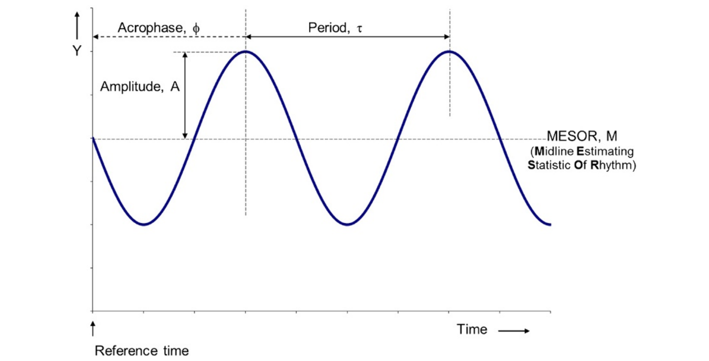

# Using rhythmCI: A Quick Guide

## Load the package

``` r

library(rhythmCI)
```

## Introduction

Understanding rhythmic patterns is essential for uncovering
time-dependent biological processes. However, analyzing rhythmicity in
gene expression datasets can be complex, involving normalization,
statistical modeling, and careful visualization.

The `rhythmCI` package is designed to simplify these steps. It provides
a streamlined workflow to:

- Load and normalize Nanostring nCounter data
- Perform rhythm analysis using the **Harmonic Regression method**
- Estimate confidence intervals for amplitude
- Generate informative visualizations

This vignette introduces the core functions of `rhythmCI` and
demonstrates how to use them on a typical time-series Nanostring
nCounter dataset. By the end of this guide, you will be able to perform
a complete rhythm analysis from raw data to visualization.

While designed for gene expression data, the functions for rhythm
analysis, confidence interval estimation, and visualization are broadly
applicable and can be used with other types of biological data,
including proteomics.

## Normalization and RLE plot

### Introduction

NanoString nCounter system produces RCC files (nCounter data files)
containing counts for each gene measured in the gene expression assays.
To ensure reliability and preciseness in the downstream statistical
analysis, proper normalization of nCounter data against reference
controls is of utmost importance. The fact that one normalization method
is not always suitable for all datasets, the flexibility to choose
‘*none*’ or ‘*nSolver*’ \[1\] or ‘*RUVg*’ \[2\] \[3\] normalization is
available in this package. Specific steps are described in the form of a
flow diagram below:  


For more detailed information concerning NanoString nCounter experiment,
please refer to
<https://university.nanostring.com/gene-expression-data-analysis-guidelines>

### Loading and normalizing Nanostring nCounter gene expression data

We demonstrate the normalization step using a publicly available
circadian dataset from Gene Expression Omnibus (GEO) \[4\].

As part of quality control, genes in the samples that are below the
Limit Of Detection (LOD) needs to be checked. For which, we recommend to
follow the ‘*No normalization*’ steps below. The ‘*df1_lodmatrix*’ will
have a TRUE value in the matrix when a gene is below the LOD. Those
genes that are below the LOD need to be filtered using any of your
preferred choice. After which, the data can be RUVg normalized using the
function `normalizeruvg`. nSolver normalization is not available in this
case. If none of the genes are below the LOD, then you have the choice
of using both normalization methods using `loadnormalizercc` function.

Since RUVg normalization uses Housekeeping genes, the user needs to
ensure that the Housekeeping genes are consistent and are not associated
with any biology of interest. To understand more about defining a
k-value, we recommend this article \[5\].

``` r

# Path to the sample data that is included within the package
path_to_rcc <- system.file("extdata", "GSE146530", package = "rhythmCI")
meta <- system.file("extdata", "meta_GSE146530.csv", package = "rhythmCI")

# No normalization -----------------------------------------------------------------

exp_df1 <- loadnormalizercc(dir = path_to_rcc, meta_dir = meta,
                            file_number = FALSE,
                            hkgenes = c("LOC106606270", "LOC106600007"))
df1_raw <- exp_df1$rawdata
head(df1_raw)
#>              f1_0 f1_4 f1_8 f1_12 f1_16 f1_20 f1_24 f1_28 f2_0 f2_4 f2_8 f2_12
#> LOC106565112   38   20   22    12    10    19    18    18   24   17   16    18
#> LOC106561455  130  151  137    82    96   125   135   129  115  167  136   121
#> kc1e          568  426  480   313   363   348   515   461  479  528  446   331
#> clock         266  234  247   189   205   206   310   275  236  323  208   223
#> per2           46   45   30    12    37    33    48    32   45   41   46    30
#> ciart         151   65   76    69    80   137    82    85  117  140   79   128
#>              f2_16 f2_20 f2_24 f2_28 f3_0 f3_4 f3_8 f3_12 f3_16 f3_20 f3_24
#> LOC106565112    13    26    21    17   15   23   30    23    14    22    31
#> LOC106561455    83   164   117   105  118  110  133   147    82   157   118
#> kc1e           258   614   431   419  541  415  459   382   297   521   472
#> clock          123   341   202   214  251  242  208   239   168   305   232
#> per2            13    56    65    44   49   54   67    54    34    40    27
#> ciart           87   146    71    64   90   81  148   114    49   173   100
#>              f3_28
#> LOC106565112    26
#> LOC106561455   142
#> kc1e           492
#> clock          237
#> per2            56
#> ciart           84

df1_pdata <- exp_df1$pData
head(df1_pdata)
#>       BCAC_ID                                        RCC_file_name Owner
#> f1_0       NA GSM4391698_20190109_AW_SET_N_280_AW_SET_N_280_10.RCC      
#> f1_4       NA GSM4391701_20190110_AW_SET_O_280_AW_SET_O_280_01.RCC      
#> f1_8       NA GSM4391704_20190110_AW_SET_O_280_AW_SET_O_280_04.RCC      
#> f1_12      NA GSM4391707_20190110_AW_SET_O_280_AW_SET_O_280_07.RCC      
#> f1_16      NA GSM4391710_20190110_AW_SET_O_280_AW_SET_O_280_10.RCC      
#> f1_20      NA GSM4391713_20190110_AW_SET_P_280_AW_SET_P_280_01.RCC      
#>       Comments     Date            GeneRLF SystemAPF imagingQC bindingDensityQC
#> f1_0           20190109 Salmo_Circ_1_C6885   n6_vDV1   No flag          No flag
#> f1_4           20190110 Salmo_Circ_1_C6885   n6_vDV1   No flag          No flag
#> f1_8           20190110 Salmo_Circ_1_C6885   n6_vDV1   No flag          No flag
#> f1_12          20190110 Salmo_Circ_1_C6885   n6_vDV1   No flag          No flag
#> f1_16          20190110 Salmo_Circ_1_C6885   n6_vDV1   No flag          No flag
#> f1_20          20190110 Salmo_Circ_1_C6885   n6_vDV1   No flag          No flag
#>       limitOfDetectionQC positiveLinearityQC id time ext_time  group
#> f1_0             No flag             No flag f1    0        8 group1
#> f1_4             No flag             No flag f1    4       12 group1
#> f1_8             No flag             No flag f1    8       16 group1
#> f1_12            No flag             No flag f1   12       20 group1
#> f1_16            No flag             No flag f1   16        0 group1
#> f1_20            No flag             No flag f1   20        4 group1

df1_fdata <- exp_df1$fData
head(df1_fdata)
#>                      Gene      Class
#> LOC106565112 LOC106565112 Endogenous
#> LOC106561455 LOC106561455 Endogenous
#> kc1e                 kc1e Endogenous
#> clock               clock Endogenous
#> per2                 per2 Endogenous
#> ciart               ciart Endogenous

df1_endblod <- exp_df1$num_endogenous_blod
head(df1_endblod)
#>  f1_0  f1_4  f1_8 f1_12 f1_16 f1_20 
#>     0     2     1     3     1     0

df1_lodmatrix <- exp_df1$lod_matrix
head(df1_lodmatrix)
#>               f1_0  f1_4  f1_8 f1_12 f1_16 f1_20 f1_24 f1_28  f2_0  f2_4  f2_8
#> LOC106565112 FALSE FALSE FALSE FALSE FALSE FALSE FALSE FALSE FALSE FALSE FALSE
#> LOC106561455 FALSE FALSE FALSE FALSE FALSE FALSE FALSE FALSE FALSE FALSE FALSE
#> kc1e         FALSE FALSE FALSE FALSE FALSE FALSE FALSE FALSE FALSE FALSE FALSE
#> clock        FALSE FALSE FALSE FALSE FALSE FALSE FALSE FALSE FALSE FALSE FALSE
#> per2         FALSE FALSE FALSE FALSE FALSE FALSE FALSE FALSE FALSE FALSE FALSE
#> ciart        FALSE FALSE FALSE FALSE FALSE FALSE FALSE FALSE FALSE FALSE FALSE
#>              f2_12 f2_16 f2_20 f2_24 f2_28  f3_0  f3_4  f3_8 f3_12 f3_16 f3_20
#> LOC106565112 FALSE FALSE FALSE FALSE FALSE FALSE FALSE FALSE FALSE FALSE FALSE
#> LOC106561455 FALSE FALSE FALSE FALSE FALSE FALSE FALSE FALSE FALSE FALSE FALSE
#> kc1e         FALSE FALSE FALSE FALSE FALSE FALSE FALSE FALSE FALSE FALSE FALSE
#> clock        FALSE FALSE FALSE FALSE FALSE FALSE FALSE FALSE FALSE FALSE FALSE
#> per2         FALSE FALSE FALSE FALSE FALSE FALSE FALSE FALSE FALSE FALSE FALSE
#> ciart        FALSE FALSE FALSE FALSE FALSE FALSE FALSE FALSE FALSE FALSE FALSE
#>              f3_24 f3_28
#> LOC106565112 FALSE FALSE
#> LOC106561455 FALSE FALSE
#> kc1e         FALSE FALSE
#> clock        FALSE FALSE
#> per2         FALSE FALSE
#> ciart        FALSE FALSE

# nSolver normalization ------------------------------------------------------------

exp_df2 <- loadnormalizercc(dir = path_to_rcc, meta_dir = meta,
                            file_number = FALSE,
                            normalization = "nSolver",
                            hkgenes = c("LOC106606270", "LOC106600007"), 
                            phenoDataRccColName = 'files.RCC')

df2_nsolverexpset <- exp_df2$nsolverexpset

df2_nsolvernormlog2 <- exp_df2$nsolvernormlog2
head(df2_nsolvernormlog2)
#>                  f1_0     f1_4     f1_8    f1_12    f1_16    f1_20    f1_24
#> LOC106565112 4.784551 4.512565 4.608803 4.322881 3.689950 4.416651 4.027035
#> LOC106561455 6.532571 7.368175 7.193765 6.997481 6.830431 7.072003 6.866571
#> kc1e         8.651433 8.858340 8.995134 8.917062 8.738313 8.541806 8.790335
#> clock        7.559844 7.996765 8.039437 8.192297 7.917019 7.788210 8.059879
#> per2         5.053737 5.643810 5.039437 4.322881 5.478446 5.182186 5.393818
#> ciart        6.747076 6.164642 6.352027 6.751724 6.570369 7.203248 6.154147
#>                 f1_28     f2_0     f2_4     f2_8    f2_12    f2_16    f2_20
#> LOC106565112 4.190486 4.575716 3.934287 4.206934 4.240768 4.611294 4.317589
#> LOC106561455 6.964926 6.789840 7.156680 7.217503 6.923578 7.196256 6.929024
#> kc1e         8.794308 8.838750 8.811486 8.923602 8.367880 8.820747 8.827144
#> clock        8.051083 7.820603 8.104212 7.826830 7.800196 7.758135 7.980554
#> per2         4.986953 5.455421 5.156680 5.674060 4.947037 4.611294 5.395591
#> ciart        6.368823 6.814503 6.903914 6.441399 7.004068 7.263370 6.762374
#>                 f2_24    f2_28     f3_0     f3_4     f3_8    f3_12    f3_16
#> LOC106565112 4.446299 4.288301 3.882652 4.588079 4.827917 4.558136 4.419483
#> LOC106561455 6.869510 6.846296 6.777470 6.797532 6.939810 7.182627 6.887632
#> kc1e         8.741755 8.832621 8.964801 8.703556 8.719211 8.554374 8.731761
#> clock        7.652203 7.866568 7.859932 7.927929 7.581080 7.880064 7.913472
#> per2         6.031261 5.610229 5.526508 5.784476 5.961184 5.754533 5.641876
#> ciart        6.156792 6.140743 6.390447 6.360668 7.092889 6.818663 6.156449
#>                 f3_20    f3_24    f3_28
#> LOC106565112 4.247908 5.116559 4.741933
#> LOC106561455 7.028127 7.011377 7.146916
#> kc1e         8.752252 9.002256 8.932489
#> clock        7.981734 7.980745 7.881863
#> per2         5.081898 4.923914 5.819935
#> ciart        7.167290 6.774771 6.396436

df2_pdata <- exp_df2$pData

df2_fdata <- exp_df2$fData

df2_endblod <- exp_df2$num_endogenous_blod

# RUVg normalization ---------------------------------------------------------------

exp_df3 <- loadnormalizercc(dir = path_to_rcc, meta_dir = meta,
                            file_number = FALSE,
                            normalization = "RUVg",
                            hkgenes = c("LOC106606270", "LOC106600007"), k=3)

df3_set <- exp_df3$set

df3_vsd <- exp_df3$vsd

df3_ruvgnormlog2 <- exp_df3$ruvgnormlog2
head(df3_ruvgnormlog2)
#>                  f1_0     f1_4     f1_8    f1_12    f1_16    f1_20    f1_24
#> LOC106565112 4.754888 4.459432 4.459432 4.169925 3.700440 4.459432 3.906891
#> LOC106561455 6.584963 7.330917 7.149747 6.930737 6.894818 7.098032 6.857981
#> kc1e         8.703904 8.823367 8.879583 8.900867 8.891784 8.672425 8.741467
#> clock        7.531381 7.888743 7.965784 8.194757 7.960002 7.832890 8.022368
#> per2         5.044394 5.523562 4.954196 4.169925 5.459432 5.129283 5.357552
#> ciart        6.820179 6.569856 6.614710 6.727920 6.375039 7.022368 6.266787
#>                 f1_28     f2_0     f2_4     f2_8    f2_12    f2_16    f2_20
#> LOC106565112 4.169925 4.584963 3.807355 4.000000 4.321928 4.392317 4.247928
#> LOC106561455 7.011227 6.906891 7.159871 7.129283 6.988685 7.087463 6.845490
#> kc1e         8.839204 8.977280 8.724514 8.864186 8.519636 8.689998 8.813781
#> clock        8.049849 7.864186 8.087463 7.845490 7.845490 7.754888 7.977280
#> per2         4.954196 5.491853 5.169925 5.643856 4.906891 4.523562 5.321928
#> ciart        6.357552 6.629357 6.942515 6.303781 6.807355 7.257388 6.768184
#>                 f2_24    f2_28     f3_0     f3_4     f3_8    f3_12    f3_16
#> LOC106565112 4.321928 4.169925 3.906891 4.459432 4.700440 4.754888 4.321928
#> LOC106561455 6.857981 6.857981 6.741467 6.714246 6.977280 7.199672 6.882643
#> kc1e         8.703904 8.804131 8.974415 8.581201 8.682995 8.764872 8.731319
#> clock        7.658211 7.918863 7.845490 7.870365 7.614710 7.942515 7.870365
#> per2         6.044394 5.643856 5.459432 5.727920 6.022368 5.643856 5.584963
#> ciart        6.087463 5.930737 6.442943 6.539159 6.930737 6.569856 6.285402
#>                 f3_20    f3_24    f3_28
#> LOC106565112 4.169925 4.906891 4.700440
#> LOC106561455 7.118941 7.066089 6.918863
#> kc1e         8.778077 8.921841 8.800900
#> clock        7.994353 8.016808 7.794416
#> per2         5.129283 5.000000 5.643856
#> ciart        7.098032 6.599913 6.700440

df3_pdata <- exp_df3$pData

df3_fdata <- exp_df3$fData

df3_endblod <- exp_df3$num_endogenous_blod

# When the data has been loaded, quality-checked and is ready to be normalized -----

exp_df3 <- normalizeruvg(rawdata = df1_raw,
   fData = df1_fdata,
   pData = df1_pdata,
   hkgenes = c("LOC106606270", "LOC106600007"),
   exclude = NULL,
   k=3)

df3_set <- exp_df3$set

df3_vsd <- exp_df3$vsd

df3_ruvgnormlog2 <- exp_df3$ruvgnormlog2
```

### RLE plots

The Relative Log Expression (RLE) plot \[6\] can be created for a raw
expression gene matrix or a log2 transformed matrix of normalized genes.

``` r

# Log2 transformed raw values before normalization
# Rows 1 to 55 correspond to the genes measured
create_RLEplot(log2(df1_raw[1:54,]), ylim = c(-2,2))
```


``` r

# Log2 transformed values after nsolver normalization
create_RLEplot(df2_nsolvernormlog2[1:54,], ylim = c(-2,2))
```


``` r

# Log2 transformed values after RUVg normalization
create_RLEplot(df3_ruvgnormlog2[1:54,], ylim = c(-2,2))
```


  

## Rhythmicity characterization

### Introduction

A well-known parametric method of detecting rhythmicity is by fitting a
regression line in terms of cosine functions also termed as harmonic
regression method \[7\]. By employing the least squares method, the
harmonic regression model uses three parameters to describe rhythms as
depicted in the image below: phase (the time of the curve’s peak),
amplitude (half-length of the difference between the peak and trough)
and magnitude (mean value of the time-series, also called as mesor).
Whereas the period (length of time for one cycle) is fixed and chosen
based on the organism.  



  
The model can be expressed as:

``` math
y(t) = m + p \cos\!\left(\frac{2 \pi t}{\tau}\right) + q \sin\!\left(\frac{2 \pi t}{\tau}\right)
```
where the amplitude $`A`$ and phase $`\phi`$ are calculated from $`p`$
and $`q`$ as:

``` math
A = \sqrt{p^2 + q^2}, \quad \phi = \arctan(\frac{q}{p})
```

Therefore, $`m`$ is the baseline expression level and $`\tau`$ is the
period.

Gunnar Lachmann et al. extended this method to evaluate the rhythmicity
of genes or components. Their approach combines amplitude estimation
from the regression fit with bootstrapping to assess rhythmicity. Our
implementation of rhythmicity detection adopts a similar strategy, with
adaptations tailored to the current workflow. For detailed information,
check the documentation of the function
[`?rhythmicity`](https://jayanth-sreekanth.github.io/rhythmCI/reference/rhythmicity.md)
or the article\[8\].

### Detecting rhythmic components

In this example, we use synthetic data generated using Simphony \[9\] to
illustrate the function.

``` r

# Load the data as part of the package
data(simdf)

head(simdf)
#>       feature_01 feature_02 feature_03 feature_04 feature_05 feature_06
#> P1_0    10.26562   10.52552   5.459432   9.590587   8.098032   6.942515
#> P1_4    10.64926   10.60918   5.357552   9.749869   8.392317   7.900867
#> P1_8    10.65284   10.61747   5.930737   9.911392   8.438792   7.888743
#> P1_12   10.31061   10.38046   5.169925   9.656425   8.108524   7.219169
#> P1_16    9.94398   10.43567   5.044394   9.475733   7.832890   6.209453
#> P1_20    9.97298   10.48382   4.857981   9.330917   7.781360   6.554589
#>       feature_07 feature_08 feature_09 feature_10
#> P1_0    8.807355   4.459432   8.129283   8.679480
#> P1_4   10.578373   5.643856   8.607330   9.964341
#> P1_8   10.572700   5.129283   8.710806  10.011227
#> P1_12   8.900867   4.247928   8.209453   8.791163
#> P1_16   7.066089   2.807355   7.960002   6.977280
#> P1_20   7.276124   3.321928   7.851749   7.434628

output_hr <- rhythmicity(input = simdf,
                         operation = "matrix",
                         seed = 7,
                         tau = 24, #value in general for humans
                         num_boot = 3999,
                         alpha = 0.05,
                         fc_cutoff = 0.5)

head(output_hr$P1)
#>            ci.lower ci.upper  rhythmicity hr.mesor hr.amplitude hr.phase
#> feature_01    0.362    0.434   arrhythmic   10.304        0.400    1.574
#> feature_02    0.012    0.173   arrhythmic   10.499        0.096    1.186
#> feature_03    0.129    0.702 inconclusive    5.283        0.406    1.747
#> feature_04    0.152    0.371   arrhythmic    9.639        0.249    1.702
#> feature_05    0.230    0.449   arrhythmic    8.086        0.357    1.756
#> feature_06    0.658    1.064     rhythmic    7.122        0.874    1.603
```

## Visualization of rhythmicity results

In this example, we use the output of the rhythmicity function and apply
additional data transformations so that the results can be visualized.

``` r

# Loading required packages
library(dplyr)
library(tidyverse)
library(ggplot2)

# Combining the data frames in the list into a single data frame
tbl_final <- do.call(rbind, output_hr)

# Creating a column denoting patients and features
tbl_final[,'patient'] <- stringr::str_split(rownames(tbl_final), 
                                            pattern = '\\.', simplify = TRUE)[, 1]
tbl_final[,'features'] <- stringr::str_split(rownames(tbl_final), 
                                             pattern = '\\.', simplify = TRUE)[, 2]
rownames(tbl_final) <- NULL

# Setting Variable Types
tbl_final <- tbl_final %>% mutate(rhythmicity = as.factor(rhythmicity),
                                  features = as.factor(features))

# Creating a primary data frame for the images
simdf_img <- as.data.frame(t(simdf))

# Creating a "Gene" column with row name entries
simdf_img <- simdf_img %>% mutate(Gene = row.names(simdf_img))
head(simdf_img)
#>                 P1_0      P1_4      P1_8     P1_12     P1_16     P1_20
#> feature_01 10.265615 10.649256 10.652845 10.310613  9.943980  9.972980
#> feature_02 10.525521 10.609179 10.617467 10.380461 10.435670 10.483816
#> feature_03  5.459432  5.357552  5.930737  5.169925  5.044394  4.857981
#> feature_04  9.590587  9.749869  9.911392  9.656425  9.475733  9.330917
#> feature_05  8.098032  8.392317  8.438792  8.108524  7.832890  7.781360
#> feature_06  6.942515  7.900867  7.888743  7.219169  6.209453  6.554589
#>                P1_24      P2_0      P2_4      P2_8     P2_12     P2_16
#> feature_01 10.330917 10.298063 10.395534 10.379378 10.337622 10.134426
#> feature_02 10.477758 10.504819 10.749031 10.787903 10.422065 10.153552
#> feature_03  5.087463  5.426265  5.554589  5.807355  4.906891  4.392317
#> feature_04  9.727920  9.645658  9.879583 10.005625  9.603626  9.312883
#> feature_05  7.882643  8.169925  8.179909  8.330917  8.194757  7.774787
#> feature_06  7.108524  7.499846  8.768184  8.857981  7.179909  5.321928
#>                P2_20     P2_24      P3_0      P3_4      P3_8     P3_12
#> feature_01 10.239599 10.354249 10.326429 10.533330 10.649256 10.317413
#> feature_02 10.292322 10.532356 10.424166 10.695228 10.688250 10.414685
#> feature_03  4.584963  5.209453  4.523562  5.426265  5.209453  5.044394
#> feature_04  9.296916  9.541097  9.658211 10.020980  9.970106  9.651052
#> feature_05  7.977280  8.308339  8.262095  8.479780  8.679480  8.055282
#> feature_06  5.169925  7.159871  6.768184  8.228819  8.317413  7.276124
#>                P3_16     P3_20     P3_24      P4_0      P4_4      P4_8
#> feature_01 10.004220 10.060696 10.263269 10.306062 10.622052 10.540128
#> feature_02 10.228819 10.169925 10.522582 10.440869 10.907642 10.902375
#> feature_03  5.247928  5.044394  4.807355  5.000000  5.614710  5.357552
#> feature_04  9.271463  9.364135  9.629357  9.643856  9.899357  9.881114
#> feature_05  7.857981  7.651052  8.098032  8.189825  8.238405  8.129283
#> feature_06  6.000000  6.066089  7.149747  7.276124  8.643856  8.611025
#>                P4_12     P4_16     P4_20     P4_24      P5_0      P5_4
#> feature_01 10.382624  9.965784  9.856426 10.314017 10.314017 10.540128
#> feature_02 10.410451 10.038919 10.121534 10.463524 10.522582 10.888743
#> feature_03  5.392317  5.285402  5.000000  5.523562  5.392317  5.832890
#> feature_04  9.658211  9.453271  9.339850  9.659996  9.605480  9.746514
#> feature_05  8.060696  8.098032  7.994353  8.199672  8.113742  8.438792
#> feature_06  7.129283  5.614710  5.727920  7.375039  6.918863  7.787903
#>                 P5_8     P5_12     P5_16     P5_20     P5_24       Gene
#> feature_01 10.639341 10.288866 10.078151  9.930737 10.314017 feature_01
#> feature_02 10.863412 10.474720 10.166163 10.257388 10.517669 feature_02
#> feature_03  5.781360  5.285402  5.491853  4.321928  5.087463 feature_03
#> feature_04  9.763212  9.519636  9.449149  9.622052  9.640245 feature_04
#> feature_05  8.233620  8.071462  7.754888  7.894818  8.252665 feature_05
#> feature_06  7.912889  7.199672  6.754888  6.442943  7.189825 feature_06

# Transforming the dataframe from wide to long format
simdf_img <- gather(simdf_img, Patient, Expression, -Gene)

# Creating a column for Time and Patient
simdf_img$Time <- stringr::str_split(simdf_img$Patient , 
                                     pattern = '\\_', simplify = TRUE)[,2]
simdf_img$Patient <- stringr::str_split(simdf_img$Patient , 
                                        pattern = '\\_', simplify = TRUE)[,1]

# Ordering the entries
simdf_img <- simdf_img[order(simdf_img$Gene, as.integer(simdf_img$Time)), ]
rownames(simdf_img) <- NULL

# Joining to have other necessary variables
simdf_img_1 <- full_join(simdf_img, tbl_final, 
                         by = c('Patient' = 'patient','Gene' = 'features'),
                         keep = F)

# Creating a plot to show Gene expression levels across time for each patient (columns) and gene (rows). 
# The fitted regression curves are overlaid and colored according to the rhythmicity status.
ggplot(simdf_img_1, 
       aes(x=as.integer(Time), y=as.double(Expression), color=rhythmicity, group = rhythmicity)) +
  geom_point(size = 0.3) + 
  geom_smooth(formula = 'y~x', method = "loess", linewidth=1.3, se=FALSE, span=0.75) +
  facet_grid(Gene~Patient, scales = "free_y") +
  theme_bw(base_size = 12) +
  scale_color_manual(values = c('aquamarine3','grey','brown2'),
                     labels = c('arrhythmic','inconclusive','rhythmic')) +
  theme(axis.text = element_text(size=12, face = 'bold'), 
        axis.title = element_text(size=15, face = 'bold'),
        strip.background = element_rect(fill = 'white'),
        strip.text = element_text(size = 15, face = 'bold.italic'),
        panel.spacing = unit(8, "pt"), legend.margin = margin(t=-5),
        legend.text = element_text(size=15, face = 'bold'),
        legend.title = element_text(size=15, face = 'bold')) +
  xlab("Time") + ylab("Log2 expression")
```


``` r

# Creating a plot to display the Confidence Interval of amplitude estimates
ggplot(tbl_final, aes(color=rhythmicity)) +
  geom_linerange(aes(ymin = ci.lower, ymax = ci.upper, x=fct_rev(features)),
                 linewidth = 3) +
  facet_wrap(~patient, ncol = 5) +
  coord_flip() +
  # make sure to change the value of yintercept based on cutoff defined
  geom_hline(yintercept=0.5,color = "black", linewidth= 0.5) + 
  scale_y_continuous(breaks = c(0,1,2,3), limits = c(0,3)) +
  scale_color_manual(values = c('aquamarine4','grey','brown2')) + 
  xlab('Features') + ylab (expression(log[2]-fold~CIs~of~Amplitudes)) +
  theme_bw() +
  theme(axis.text = element_text(size=12, face = 'bold'), 
        axis.title = element_text(size=15, face = 'bold'),
        strip.background = element_rect(fill = 'white'),
        strip.text = element_text(size = 15, face = 'bold.italic'),
        panel.spacing = unit(8, "pt"), legend.margin = margin(t=-5),
        legend.text = element_text(size=15, face = 'bold'),
        legend.title = element_text(size=15, face = 'bold'))
```


## References

1\. Aboyoun P, Ortogero N, Yang Z, Reeves J, Gorman K, Vitancol R, et
al. NanoStringNCTools: NanoString nCounter tools. NanoString
Technologies: Seattle, WA, USA. 2023.

2\. Risso D, Ngai J, Speed TP, Dudoit S. Normalization of RNA-seq data
using factor analysis of control genes or samples. Nature biotechnology.
2014;32:896–902.

3\. Bhattacharya A, Hamilton AM, Furberg H, Pietzak E, Purdue MP,
Troester MA, et al. An approach for normalization and quality control
for NanoString RNA expression data. Briefings in bioinformatics.
2021;22:bbaa163.

4\. West AC, Iversen M, Jørgensen EH, Sandve SR, Hazlerigg DG, Wood SH.
Diversified regulation of circadian clock gene expression following
whole genome duplication. PLoS genetics. 2020;16:e1009097.

5\. Gagnon-Bartsch JA, Speed TP. Using control genes to correct for
unwanted variation in microarray data. Biostatistics. 2012;13:539–52.

6\. Gandolfo LC, Speed TP. RLE plots: Visualizing unwanted variation in
high dimensional data. PloS one. 2018;13:e0191629.

7\. Cornelissen G. Cosinor-based rhythmometry. Theoretical Biology and
Medical Modelling. 2014;11:1–24.

8\. Lachmann G, Ananthasubramaniam B, Wünsch VA, Scherfig L-M, Haefen C
von, Knaak C, et al. Circadian rhythms in septic shock patients. Annals
of intensive care. 2021;11:1–10.

9\. Singer JM, Fu DY, Hughey JJ. Simphony: Simulating large-scale,
rhythmic data. PeerJ. 2019;7:e6985.
