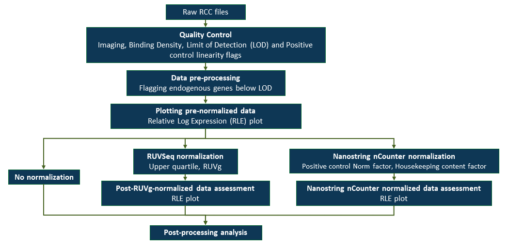

```{r, include = FALSE}
knitr::opts_chunk$set(
  collapse = TRUE,
  comment = "#>",
  warning = FALSE
)
```

## Load the package

```{r setup, message=FALSE} 
library(rhythmCI)
```

## Introduction

Understanding rhythmic patterns is essential for uncovering time-dependent biological processes. However, analyzing rhythmicity in gene expression datasets can be complex, involving normalization, statistical modeling, and careful visualization.

The `rhythmCI` package is designed to simplify these steps. It provides a streamlined workflow to:

- Load and normalize Nanostring nCounter data
- Perform rhythm analysis using the **Harmonic Regression method**
- Estimate confidence intervals for amplitude
- Generate informative visualizations

This vignette introduces the core functions of `rhythmCI` and demonstrates how to use them on a typical time-series Nanostring nCounter dataset. By the end of this guide, you will be able to perform a complete rhythm analysis from raw data to visualization.

While designed for gene expression data, the functions for rhythm analysis, confidence interval estimation, and visualization are broadly applicable and can be used with other types of biological data, including proteomics.

## Normalization and RLE plot

### Introduction
NanoString nCounter system produces RCC files (nCounter data files) containing counts for each gene measured in the gene expression assays. To ensure reliability and preciseness in the downstream statistical analysis, proper normalization of nCounter data against reference controls is of utmost importance. The fact that one normalization method is not always suitable for all datasets, the flexibility to choose ‘*none*’ or ‘*nSolver*’ [@aboyoun2022nanostringnctools] or ‘*RUVg*’ [@bhattacharya2021approach] normalization is available in this package. Specific steps are described in the form of a flow diagram below:
\



For more detailed information concerning NanoString nCounter experiment, please refer to <https://university.nanostring.com/gene-expression-data-analysis-guidelines>


### Loading and normalizing Nanostring nCounter gene expression data
We demonstrate the normalization step using a publicly available circadian dataset from Gene Expression Omnibus (GEO) [@west2020diversified].

As part of quality control, genes in the samples that are below the Limit Of Detection (LOD) needs to be checked. For which, we recommend to follow the '*No normalization*' steps below. The '*df1_lodmatrix*' will have a TRUE value in the matrix when a gene is below the LOD. Those genes that are below the LOD need to be filtered using any of your preferred choice. After which, the data can be RUVg normalized using the function `normalizeruvg`. nSolver normalization is not available in this case. If none of the genes are below the LOD, then you have the choice of using both normalization methods using `loadnormalizercc` function.

Since RUVg normalization uses Housekeeping genes, the user needs to ensure that the Housekeeping genes are consistent and are not associated with any biology of interest. To understand more about defining a k-value, we recommend this article [@gagnon2012using]. 

```{r loadnormalizercc, warning=FALSE, message=FALSE}
# Path to the sample data that is included within the package
path_to_rcc <- system.file("extdata", "GSE146530", package = "rhythmCI")
meta <- system.file("extdata", "meta_GSE146530.csv", package = "rhythmCI")

# No normalization -----------------------------------------------------------------

exp_df1 <- loadnormalizercc(dir = path_to_rcc, meta_dir = meta,
                            file_number = FALSE,
                            hkgenes = c("LOC106606270", "LOC106600007"))
df1_raw <- exp_df1$rawdata
head(df1_raw)

df1_pdata <- exp_df1$pData
head(df1_pdata)

df1_fdata <- exp_df1$fData
head(df1_fdata)

df1_endblod <- exp_df1$num_endogenous_blod
head(df1_endblod)

df1_lodmatrix <- exp_df1$lod_matrix
head(df1_lodmatrix)

# nSolver normalization ------------------------------------------------------------

exp_df2 <- loadnormalizercc(dir = path_to_rcc, meta_dir = meta,
                            file_number = FALSE,
                            normalization = "nSolver",
                            hkgenes = c("LOC106606270", "LOC106600007"), 
                            phenoDataRccColName = 'files.RCC')

df2_nsolverexpset <- exp_df2$nsolverexpset

df2_nsolvernormlog2 <- exp_df2$nsolvernormlog2
head(df2_nsolvernormlog2)

df2_pdata <- exp_df2$pData

df2_fdata <- exp_df2$fData

df2_endblod <- exp_df2$num_endogenous_blod

# RUVg normalization ---------------------------------------------------------------

exp_df3 <- loadnormalizercc(dir = path_to_rcc, meta_dir = meta,
                            file_number = FALSE,
                            normalization = "RUVg",
                            hkgenes = c("LOC106606270", "LOC106600007"), k=3)

df3_set <- exp_df3$set

df3_vsd <- exp_df3$vsd

df3_ruvgnormlog2 <- exp_df3$ruvgnormlog2
head(df3_ruvgnormlog2)

df3_pdata <- exp_df3$pData

df3_fdata <- exp_df3$fData

df3_endblod <- exp_df3$num_endogenous_blod

# When the data has been loaded, quality-checked and is ready to be normalized -----

exp_df3 <- normalizeruvg(rawdata = df1_raw,
   fData = df1_fdata,
   pData = df1_pdata,
   hkgenes = c("LOC106606270", "LOC106600007"),
   exclude = NULL,
   k=3)

df3_set <- exp_df3$set

df3_vsd <- exp_df3$vsd

df3_ruvgnormlog2 <- exp_df3$ruvgnormlog2

```

### RLE plots
The Relative Log Expression (RLE) plot [@gandolfo2018rle] can be created for a raw expression gene matrix or a log2 transformed matrix of normalized genes.

```{r rle_plot, fig.width=8, fig.height=5, out.width="80%", fig.align='center'}
create_RLEplot(df3_ruvgnormlog2)

```

\

## Rhythmicity characterization

### Introduction
A well-known parametric method of detecting rhythmicity is by fitting a regression line in terms of cosine functions also termed as harmonic regression method [@cornelissen2014cosinor]. By employing the least squares method, the harmonic regression model uses three parameters to describe rhythms as depicted in the image below: phase (the time of the curve’s peak), amplitude (half-length of the difference between the peak and trough) and magnitude (mean value of the time-series, also called as mesor). Whereas the period (length of time for one cycle) is fixed and chosen based on the organism.
\


\
The model can be expressed as:

$$
y(t) = m + p \cos\!\left(\frac{2 \pi t}{\tau}\right) + q \sin\!\left(\frac{2 \pi t}{\tau}\right)
$$
where the amplitude $A$ and phase $\phi$ are calculated from $p$ and $q$ as:

$$
A = \sqrt{p^2 + q^2}, \quad \phi = \arctan(\frac{q}{p})
$$

Therefore, $m$ is the baseline expression level and $\tau$ is the period.

Gunnar Lachmann et al. extended this method to evaluate the rhythmicity of genes or components. Their approach combines amplitude estimation from the regression fit with bootstrapping to assess rhythmicity. Our implementation of rhythmicity detection adopts a similar strategy, with adaptations tailored to the current workflow. For detailed information, check the documentation of the function `?rhythmicity` or the article[@lachmann2021circadian]. 

### Detecting rhythmic components

In this example, we use synthetic data generated using Simphony [@singer2019simphony] to illustrate the function.

```{r rhythmicity, warning=FALSE}
# Load the data as part of the package
data(simdf)

head(simdf)

output_hr <- rhythmicity(input = simdf,
                         operation = "matrix",
                         seed = 7,
                         tau = 24, #value in general for humans
                         num_boot = 999,
                         alpha = 0.05,
                         fc_cutoff = 0.5)

head(output_hr$P1)

```

## Visualization of rhythmicity results

In this example, we use the output of the rhythmicity function and apply additional data transformations so that the results can be visualized.

```{r visual rhythmicity, warning=FALSE, message=FALSE, fig.width=6, fig.height=18, fig.align="center"}
# Loading required packages
library(dplyr)
library(tidyverse)
library(ggplot2)

# Combining the data frames in the list into a single data frame
tbl_final <- do.call(rbind, output_hr)

# Creating a column denoting patients and features
tbl_final[,'patient'] <- stringr::str_split(rownames(tbl_final), 
                                            pattern = '\\.', simplify = TRUE)[, 1]
tbl_final[,'features'] <- stringr::str_split(rownames(tbl_final), 
                                             pattern = '\\.', simplify = TRUE)[, 2]
rownames(tbl_final) <- NULL

# Setting Variable Types
tbl_final <- tbl_final %>% mutate(rhythmicity = as.factor(rhythmicity),
                                  features = as.factor(features))

# Creating a primary data frame for the images
simdf_img <- as.data.frame(t(simdf))

# Creating a "Gene" column with row name entries
simdf_img <- simdf_img %>% mutate(Gene = row.names(simdf_img))
head(simdf_img)

# Transforming the dataframe from wide to long format
simdf_img <- gather(simdf_img, Patient, Expression, -Gene)

# Creating a column for Time and Patient
simdf_img$Time <- stringr::str_split(simdf_img$Patient , 
                                     pattern = '\\_', simplify = TRUE)[,2]
simdf_img$Patient <- stringr::str_split(simdf_img$Patient , 
                                        pattern = '\\_', simplify = TRUE)[,1]

# Ordering the entries
simdf_img <- simdf_img[order(simdf_img$Gene, as.integer(simdf_img$Time)), ]
rownames(simdf_img) <- NULL

# Joining to have other necessary variables
simdf_img_1 <- full_join(simdf_img, tbl_final, 
                         by = c('Patient' = 'patient','Gene' = 'features'),
                         keep = F)

# Creating a plot to show Gene expression levels across time for each patient (columns) and gene (rows). 
# The fitted regression curves are overlaid and colored according to the rhythmicity status.
ggplot(simdf_img_1, 
       aes(x=as.integer(Time), y=as.double(Expression), color=rhythmicity, group = rhythmicity)) +
  geom_point(size = 0.3) + 
  geom_smooth(formula = 'y~x', method = "loess", linewidth=1.3, se=FALSE, span=0.75) +
  facet_grid(Gene~Patient, scales = "free_y") +
  theme_bw(base_size = 12) +
  scale_color_manual(values = c('aquamarine3','grey','brown2'),
                     labels = c('arrhythmic','inconclusive','rhythmic')) +
  theme(axis.text = element_text(size=10, face = 'bold'), 
        axis.title = element_text(size=12, face = 'bold'),
        axis.ticks.length = unit(4, "pt"), 
        panel.spacing = unit(8, "pt"), legend.margin = margin(t=-5),
        strip.text = element_text(size = 10, face = 'bold')) +
  xlab("Time") + ylab("Log2 expression")
```

```{r visual_CI, warning=FALSE, message=FALSE, fig.width=7, fig.height=5, fig.align="center"}
# Creating a plot to display the Confidence Interval of amplitude estimates
ggplot(tbl_final, aes(color=rhythmicity)) +
  geom_linerange(aes(ymin = ci.lower, ymax = ci.upper, x=fct_rev(features)),
                 linewidth = 3) +
  facet_wrap(~patient, ncol = 6) +
  coord_flip() +
  # make sure to change the value of yintercept based on cutoff defined
  geom_hline(yintercept=0.5,color = "black", linewidth= 0.5) + 
  scale_color_manual(values = c('aquamarine3','grey','brown2')) + 
  xlab('Features') + ylab (expression(log[2]-fold~CIs~of~Amplitudes)) +
  theme_bw(base_size = 16)

```

## References


