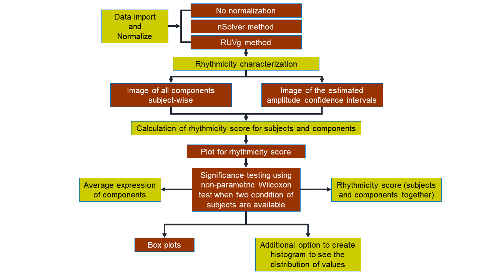

```{r, include = FALSE}
knitr::opts_chunk$set(
  collapse = TRUE,
  comment = "#>"
)
```

## Load the package

```{r setup, message=FALSE} 
library(rhythmCI)
```

## Introduction

Understanding rhythmic patterns is essential for uncovering time-dependent biological processes. However, analyzing rhythmicity in gene expression datasets can be complex, involving normalization, statistical modeling, and careful visualization.

The `rhythmCI` package is designed to simplify these steps. It provides a streamlined workflow to:

- Load and normalize Nanostring nCounter data
- Perform rhythm analysis using the **Harmonic Regression method**
- Estimate confidence intervals for amplitude
- Generate informative visualizations

This vignette introduces the core functions of `rhythmCI` and demonstrates how to use them on a typical time-series Nanostring nCounter dataset. By the end of this guide, you will be able to perform a complete rhythm analysis from raw data to visualization.

### Visual illustration of the workflow
\



## Normalization and RLE plot

### Short introduction
NanoString nCounter system produces RCC files (nCounter data files) containing counts for each gene measured in the gene expression assays. To ensure reliability and preciseness in the downstream statistical analysis, proper normalization of nCounter data against reference controls is of utmost importance. The fact that one normalization method is not always suitable for all datasets, the flexibility to choose ‘*none*’ or ‘*nSolver*’ or ‘*RUVg*’ normalization is available in this package. Specific steps are described in the form of a flow diagram below:
\


For more detailed information concerning NanoString nCounter experiment, please refer to <https://university.nanostring.com/gene-expression-data-analysis-guidelines>

### Loading and Normalizing Nanostring nCounter gene expression data

```{r loadnormalizercc}
path_to_rcc <- system.file("extdata", "GSE146530", package = "rhythmCI")
meta <- system.file("extdata", "meta_GSE146530.csv", package = "rhythmCI")

# No normalization -----------------------------------------------------------------

exp_df1 <- loadnormalizercc(dir = path_to_rcc, meta_dir = meta,
                            file_number = FALSE,
                            hkgenes = c("LOC106606270", "LOC106600007"))
df1_raw <- exp_df1$rawdata
head(df1_raw)

df1_pdata <- exp_df1$pdata

df1_fdata <- exp_df1$fdata

df1_endblod <- exp_df1$num_endogenous_blod
head(df1_endblod)

# nSolver normalization ------------------------------------------------------------

exp_df2 <- loadnormalizercc(dir = path_to_rcc, meta_dir = meta,
                            file_number = FALSE,
                            normalization = "nSolver",
                            hkgenes = c("LOC106606270", "LOC106600007"), 
                            phenoDataRccColName = 'files.RCC')

df2_nsolverexpset <- exp_df2$nsolverexpset

df2_nsolvernormlog2 <- exp_df2$nsolvernormlog2
head(df2_nsolvernormlog2)

df2_pdata <- exp_df2$pdata

df2_fdata <- exp_df2$fdata

df2_endblod <- exp_df2$num_endogenous_blod

# RUVg normalization ---------------------------------------------------------------

exp_df3 <- loadnormalizercc(dir = path_to_rcc, meta_dir = meta,
                            file_number = FALSE,
                            normalization = "RUVg",
                            hkgenes = c("LOC106606270", "LOC106600007"), k=3)

df3_set <- exp_df3$set

df3_vsd <- exp_df3$vsd

df3_ruvgnormlog2 <- exp_df3$ruvgnormlog2
head(df3_ruvgnormlog2)

df3_pdata <- exp_df3$pdata

df3_fdata <- exp_df3$fdata

df3_endblod <- exp_df3$num_endogenous_blod
```

### RLE plots
```{r rle_plot, fig.width=8, fig.height=5, out.width="80%", fig.align='center'}
# Create a sample gene expression matrix
genes <- c("GeneA", "GeneB", "GeneC", "GeneD", "GeneE")
samples <- c("Pat1_0", "Pat1_4", "Pat1_8", "Pat2_0", "Pat2_4", "Pat2_8")

df3_ruvgnormlog2 <- matrix(c(6.2, 6.5, 6.0, 7.0, 5.8, 6.1,
                             7.5, 7.8, 7.2, 8.0, 7.0, 7.6,
                             5.9, 6.1, 5.6, 6.3, 5.4, 5.8,
                             8.1, 8.3, 8.0, 8.5, 7.9, 8.2,
                             4.2, 4.5, 4.0, 4.6, 4.1, 5.0),
                             nrow = 5,
                             byrow = TRUE)

rownames(df3_ruvgnormlog2) <- genes
colnames(df3_ruvgnormlog2) <- samples
head(df3_ruvgnormlog2)
# data(simdf)
# head(t(simdf))

create_RLEplot(df3_ruvgnormlog2, num=5)

```

# Rhythmicity characterization

### Short introduction
A well-known parametric method of detecting rhythmicity is by fitting a regression line in terms of cosine functions also termed as harmonic regression method @cornelissen2014cosinor. By employing the least squares method, the harmonic regression model uses three parameters to describe rhythms as depicted in the image below: phase (the time of the curve’s peak), amplitude (half-length of the difference between the peak and trough) and magnitude (mean value of the time-series, also called as mesor). Whereas the period (length of time for one cycle) is fixed and chosen based on the organism.
\


```{r rhythmicity, warning=FALSE}
# Load the data as part of the package
data(simdf)

output_hr <- rhythmicity(input = simdf,
                         operation = "matrix",
                         seed = 7,
                         tau = 24, #value in general for humans
                         num_boot = 999,
                         alpha = 0.05,
                         fc_cutoff = 0.5)

head(output_hr$P1)

```


